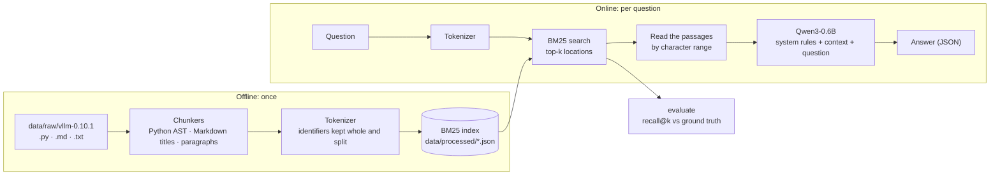
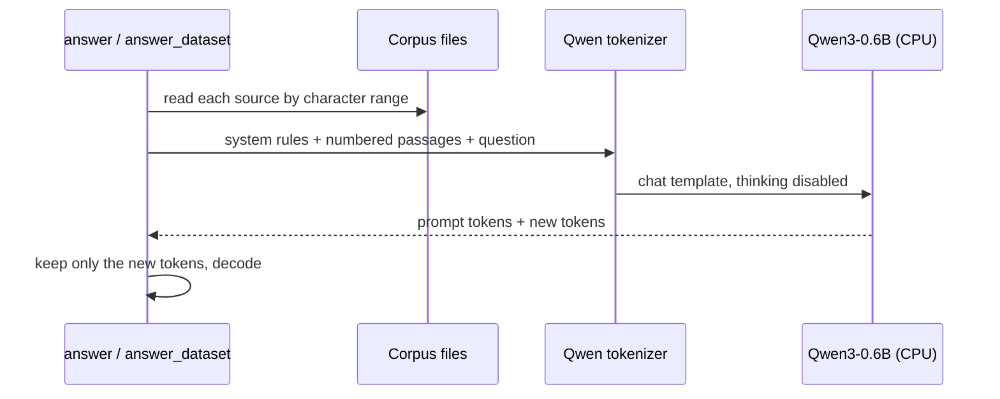

*This project has been created as part of the 42 curriculum by <login>.*

<div align="center">

# RAG against the machine

**A retrieval-augmented question answering system over the vLLM codebase, built from scratch:
structure-aware chunking, a hand-written BM25 index, and grounded answers from a small local model.**


</div>

---

## Table of contents

- [Description](#description)
- [Results at a glance](#results-at-a-glance)
- [Instructions](#instructions)
- [Example usage](#example-usage)
- [System architecture](#system-architecture)
- [Chunking strategy](#chunking-strategy)
- [Retrieval method](#retrieval-method)
- [Answer generation](#answer-generation)
- [Evaluation](#evaluation)
- [Performance analysis](#performance-analysis)
- [Design decisions](#design-decisions)
- [Challenges faced](#challenges-faced)
- [Testing and code quality](#testing-and-code-quality)
- [Project layout](#project-layout)
- [Resources](#resources)

---

## Description

A language model only knows what it was trained on. Ask it about a specific codebase and it either
refuses or invents a plausible answer. **Retrieval-Augmented Generation (RAG)** fixes this without
retraining: before answering, the system *looks up* the relevant passages in an external corpus and
gives them to the model as context.

This project builds a complete RAG pipeline over the source tree of
[vLLM 0.10.1](https://github.com/vllm-project/vllm) (about 1,850 Python, Markdown and text files):

1. **Index** the corpus: split every file into chunks that follow its structure, and build a BM25
   index that answers a query in milliseconds.
2. **Retrieve** the top-k chunks for a question, as exact locations (file path + character range).
3. **Generate** an answer with [Qwen3-0.6B](https://huggingface.co/Qwen/Qwen3-0.6B), grounded in the
   retrieved passages.
4. **Evaluate** retrieval with recall@k against labeled datasets.

Everything retrieval-related is implemented by hand (chunkers, tokenizer, BM25, evaluation): the
machine-learning libraries (PyTorch, Transformers) are only used to run the language model. The whole
system runs on a CPU.

## Results at a glance

Measured on the public datasets, with the default settings (chunks of at most 2,000 characters, k = 10):

| | Docs (100 questions) | Code (99 questions) |
|---|:---:|:---:|
| **Recall@5** | **0.820** (target ≥ 0.80) | **0.646** (target ≥ 0.50) |
| Recall@10 | 0.860 | 0.737 |
| Indexing the whole corpus | about 7 s, end to end (limit: 5 min) | |
| Searching a whole dataset | 6.8 s for 100 questions, end to end (limit: 90 s for 200) | |
| Generating one answer | about 5 s on CPU | |

---

## Instructions

### Requirements

- Python **3.12** or later and [uv](https://docs.astral.sh/uv/) (the only supported package manager).
- About **2.5 GB of free disk space**: the virtual environment with PyTorch (CPU build) and
  Transformers takes about 830 MB, and the Qwen3-0.6B weights (1.5 GB) are downloaded into the
  Hugging Face cache the first time an answer is generated.
- Internet access on the first run (model download); no GPU needed.

### Installation

```bash
git clone <repository-url>
cd RAG_against_the_machine
make install            # runs `uv sync`
```

`uv sync` installs the exact versions pinned in `uv.lock`. PyTorch comes from the
[PyTorch CPU index](https://download.pytorch.org/whl/cpu), configured in `pyproject.toml`: the default
Linux build on PyPI targets NVIDIA GPUs (CUDA), which this project does not need.

### Data layout

The commands expect the following layout (the corpus and the datasets are provided separately):

```
data/
├── raw/vllm-0.10.1/             # the corpus to index
├── processed/                   # the index, written by `index`
├── datasets/
│   ├── AnsweredQuestions/       # questions + expected sources (ground truth)
│   └── UnansweredQuestions/     # questions only
└── output/
    ├── search_results/<DatasetScope>/
    └── search_results_and_answer/<DatasetScope>/
```

### Makefile

| Rule | What it does |
|---|---|
| `make install` | install the dependencies (`uv sync`) |
| `make run ARGS="..."` | run the CLI: `uv run python -m src $(ARGS)` |
| `make debug ARGS="..."` | run the CLI under `pdb` |
| `make test` | run the test suite (`uv run pytest`) |
| `make lint` | `flake8 .` and `mypy .` with the flags required by the subject |
| `make lint-strict` | `flake8 .` and `mypy . --strict` |
| `make clean` | remove `__pycache__`, `.mypy_cache`, `.pytest_cache` and `.ruff_cache` |

---

## Example usage

Every command is run as `uv run python -m src <command> [options]`.

### 1. Build the index

```bash
uv run python -m src index --max_chunk_size 2000
```
```
Chunking: 100%|██████████| 3226/3226 [00:02<00:00, 1298.46it/s]
Ingestion complete! Indices saved under .../data/processed/bm25_index.json
```

### 2. Search one question

```bash
uv run python -m src search "What HTTP endpoint is used to dynamically load a LoRA adapter in vLLM?" --k 2
```
```json
[
  {
    "file_path": "data/raw/vllm-0.10.1/docs/features/lora.md",
    "first_character_index": 4695,
    "last_character_index": 6100
  },
  ...
]
```

### 3. Search a whole dataset

```bash
uv run python -m src search_dataset \
    --dataset_path data/datasets/UnansweredQuestions/dataset_docs_public.json \
    --k 10 \
    --save_directory data/output/search_results/UnansweredQuestions
```
```
Searching: 100%|██████████| 100/100 [00:00<00:00, ...]
Saved student_search_results to data/output/search_results/UnansweredQuestions/dataset_docs_public.json
```

### 4. Measure recall@k

```bash
uv run python -m src evaluate \
    --student_search_results_path data/output/search_results/UnansweredQuestions/dataset_docs_public.json \
    --dataset_path data/datasets/AnsweredQuestions/dataset_docs_public.json
```
```
Recall@1: 0.610 Recall@3: 0.730 Recall@5: 0.820 Recall@10: 0.860
```

### 5. Answer one question

```bash
uv run python -m src answer "What HTTP endpoint is used to dynamically load a LoRA adapter in vLLM?" --k 5
```
```
content: The HTTP endpoint used to dynamically load a LoRA adapter in vLLM is `/v1/load_lora_adapter`.
```

### 6. Answer a whole dataset

```bash
uv run python -m src answer_dataset \
    --student_search_results_path data/output/search_results/UnansweredQuestions/dataset_docs_public.json \
    --save_directory data/output/search_results_and_answer/UnansweredQuestions
```
```
Answering: 100%|██████████| 10/10 [00:48<00:00,  4.81s/it]      # measured on a 10-question sample
Saved student_search_result_and_answer to .../dataset_docs_public.json
```

### Errors never end in a traceback

Every expected problem prints a one-line message on stderr and exits with status 1:

```
$ uv run python -m src search "" --k 3
Error: The query is empty.
$ uv run python -m src search "lora" --k 0
Error: k must be a positive integer, got 0
$ uv run python -m src index --raw_dir nope
Error: Corpus folder not found: nope
```

> **Note.** Options need two ASCII hyphens (`--k`). A typographic dash pasted from a document
> (`–k`) is not an option for Python Fire: it becomes a positional value. The `index` command detects
> this case and says so.

---

## System architecture



| Stage | Package | Main pieces |
|---|---|---|
| Chunking | `src/chunking/` | `python_chunker`, `markdown_chunker`, `text_chunker`, shared `refine` pipeline |
| Retrieval | `src/retrieval/` | `tokenize`, `BM25Index` (build, search, save, load), `indexer`, `search`, `search_dataset` |
| Generation | `src/answer/` | `answer`, `answer_dataset` |
| Evaluation | `src/evaluation/` | `overlap_ratio`, `recall_at_k`, `evaluate` |
| Data models | `src/data_models/` | pydantic models exchanged between stages (`MinimalSource`, `StudentSearchResults`, ...) |
| CLI | `src/cli.py` | Python Fire commands, wrapped so that errors become messages |

The stages communicate through **files that follow the pydantic models** of the subject:
`search_dataset` writes a `StudentSearchResults` file, which `evaluate`, the official moulinette and
`answer_dataset` all read. Because of this contract, each stage can be changed or tested alone.

---

## Chunking strategy

A chunk is the unit of retrieval: what BM25 scores and what the model reads. Its boundaries decide
whether the right answer can be found at all.

**One rule for every file type.** Cut along the *structure* of the file first, and fall back to
paragraphs, then to raw size, only when a section is too big:

| File type | Structural cut | Kept together |
|---|---|---|
| Python (`.py`) | one chunk per top-level function or class, parsed with `ast`; a class bigger than the limit is split by method; the code between definitions forms its own chunks | a definition with its decorators and the comment lines right above it |
| Markdown (`.md`) | one chunk per section, starting at a `#`, `##` or `###` title | fenced code blocks, never cut when they fit in one chunk |
| Text (`.txt`) | no structure: the whole file is one section | paragraphs |

**The shared `refine` pipeline** then handles the sections bigger than `--max_chunk_size`:

1. cut at blank lines (paragraphs), never inside a protected block;
2. if a paragraph is still too big, cut it into parts of nearly equal size, preferring line breaks;
3. merge parts smaller than 300 characters with their neighbour, without crossing a title.

**Invariants**, checked by the tests on the *whole* corpus at two chunk sizes:

- the chunks of a file cover it **exactly**, in order, with no gap and no overlap;
- the text of a chunk is exactly `text[first_character_index:last_character_index]`;
- no chunk is longer than `--max_chunk_size` (the moulinette rejects the whole output otherwise).

Files are read with `newline=""` so that Windows line endings are not translated: the character
offsets then match the raw file exactly, which is what the evaluation compares.

---

## Retrieval method

### Tokenization: the decisive step for code

BM25 only matches identical tokens, so what counts as a token decides what can be found.
A question may quote an identifier (`max_num_seqs`) or paraphrase it ("maximum number of sequences").
The tokenizer serves both:

| Text | Tokens |
|---|---|
| `max_num_seqs` | `max_num_seqs`, `max`, `num`, `seqs` |
| `getModelConfig` | `getmodelconfig`, `get`, `model`, `config` |
| `Qwen3` | `qwen3`, `qwen`, `3` |

Each identifier is kept **whole** (an exact quote matches a rare, high-weight token) and **split**
on underscores, camelCase boundaries and letter/digit changes (a paraphrase matches the parts).
Everything is lowercased, one-character tokens are dropped, and duplicates are kept because BM25 needs
term frequencies. Questions and chunks go through the **same** tokenizer.

### BM25

For a query $q$ and a chunk $d$:

$$
\text{score}(q, d) = \sum_{t \in q} \text{IDF}(t)\cdot
\frac{f(t, d)\,(k_1 + 1)}{f(t, d) + k_1\left(1 - b + b\,\frac{|d|}{\text{avgdl}}\right)}
\qquad
\text{IDF}(t) = \ln\!\left(1 + \frac{N - n_t + 0.5}{n_t + 0.5}\right)
$$

- **IDF** rewards rare tokens: a token present in 4 chunks out of 29,306 weighs far more than `the`.
  This variant stays positive even for tokens present in most chunks.
- **$k_1 = 1.5$** makes repeated terms saturate: the 10th occurrence adds little.
- **$b = 0.75$** penalises long chunks, which contain more words by chance.

Both values are the usual defaults ($k_1 \in [1.2, 2.0]$, $b = 0.75$). BM25 was preferred over TF-IDF
precisely for the saturation and the length normalisation.

### Implementation

- An **inverted index** maps each token to the list of `(chunk_id, term frequency)`: a query only
  visits the chunks that share a token with it, so the ranking is identical to scoring every chunk,
  but much faster.
- The top-k is taken with `heapq.nlargest` instead of a full sort.
- The index is saved as **JSON** (21 MB for the whole corpus, loaded in about 0.5 s). A corrupted or
  missing file raises a dedicated `IndexLoadError` with a clear message.

---

## Answer generation



- **Context.** The passages are re-read from the corpus by character range and numbered with their
  file path (`[1] data/raw/vllm-0.10.1/docs/features/lora.md`).
- **Prompt.** The rules go in the **system** message: answer only from the context, in one to three
  plain sentences, and say *"I cannot answer from the provided documents."* when the context does not
  contain the answer. The **user** message holds the context first and the **question last**: models use
  information placed at the start or the end of a long input best.
- **Chat template.** Applied with `add_generation_prompt=True` (it opens the assistant's turn) and
  `enable_thinking=False`: Qwen3 then answers directly instead of writing a long reasoning block.
- **Settings.** `max_new_tokens = 256`, `temperature = 0.7`, `top_p = 0.8`, `top_k = 20`, `min_p = 0`:
  the values recommended by the Qwen3 model card for the non-thinking mode. The cap of 256 tokens comes
  from the data: the longest expected answer of the datasets is 178 tokens.
- **Output.** The prompt tokens are cut off the model output before decoding, so the answer field never
  repeats the question or the context. `answer_dataset` keeps the question ids, the questions, the
  retrieved sources and `k` of its input, and adds the answers.

---

## Evaluation

For each question, **recall@k** is the share of its expected sources found in the first k results.
An expected source counts as found when a result is in the **same file** and their character ranges
overlap with an **IoU of at least 0.05**:

```
IoU = |intersection| / |union|      e.g. expected [4000, 4300], result [3500, 5300]  →  300 / 1800 ≈ 0.17
```

The dataset score is the mean over the questions. A question missing from the results counts as 0;
a question without expected sources is left out of the mean, with a warning. The `evaluate` command
is checked against crafted files: a file that copies the ground truth scores exactly 1.000, a file
with shifted ranges exactly 0.000. The official score comes from the provided moulinette, which this
code never imports.

---

## Performance analysis

### Recall@k on the public datasets

| Chunk size | Dataset | @1 | @3 | **@5** | @10 |
|---|---|:---:|:---:|:---:|:---:|
| 2000 (default) | docs | 0.610 | 0.730 | **0.820** | 0.860 |
| 2000 (default) | code | 0.444 | 0.606 | **0.646** | 0.737 |
| 1500 | docs | 0.650 | 0.750 | **0.820** | 0.850 |
| 1500 | code | 0.434 | 0.586 | **0.667** | 0.747 |

Both targets are met with either size. The gap between @1 and @5 shows that the right source is often
found but not ranked first: ranking, not coverage, is the main room for improvement.

### Where the misses come from

With chunks of 1,500 characters, at k = 10:

| | Docs (100) | Code (99) |
|---|:---:|:---:|
| Expected source in the top 5 | 82 | 66 |
| Found, but at rank 6 to 10 | 3 | 8 |
| Right file, wrong place | 10 | 13 |
| Right file not in the top 10 | 5 | 12 |

A typical miss: *"What are the default values for FP8_MIN and FP8_MAX in the
triton_flash_attention module?"*. Its most specific token, `triton_flash_attention`, is the **file
name**, not a word of the file's content, so BM25 cannot use it.

### An experiment that was measured, then rejected

Adding the file path to the tokens of every chunk addresses exactly that kind of miss:

| Variant | Docs @5 | Code @5 | Code @10 |
|---|:---:|:---:|:---:|
| Text only (kept) | **0.820** | 0.646 | 0.737 |
| Text + file path | 0.800 | **0.747** | **0.848** |
| Text + file path, `.py` only | 0.790 | 0.747 | 0.848 |

It gains 10 points on code but brings docs down to the 0.80 threshold, with no margin left for an
unseen dataset. It was not kept; weighting the path less than the text is the next thing to try.

### Speed

| Step | Measured | Requirement |
|---|---|---|
| Chunk + index the corpus (29,306 chunks) | about 7 s end to end | ≤ 5 min |
| One BM25 query | about 3 ms | |
| `search_dataset`, 100 questions, end to end | 6.8 s | ≤ 90 s for 200 questions |
| One answer, `float32` | 5.4 s | |
| One answer, `bfloat16` | 17.1 s | |
| `answer_dataset`, with 10 passages per question | 4.8 s per question | |

The model ships in `bfloat16`, but on the CPU used for development reading a 1,000-token prompt took
16.7 s in `bfloat16` against 1.4 s in `float32`: the model is loaded in `float32`.

### Answer quality

On a sample of 10 questions (5 docs, 5 code), answers were compared by hand with the expected answers:

| Version | Correct | Partial | Wrong or off topic |
|---|:---:|:---:|:---:|
| First version (the question was missing from the prompt) | 2 | 1 | 7 |
| Question added after the context | 7 | 2 | 1 |
| + system message, `float32`, 10 passages | 8 | 2 | 0 |

This is a small, manual check, meant to compare prompts, not a benchmark.

---

## Design decisions

| Decision | Why |
|---|---|
| **Structure-aware chunking** | a function or a Markdown section is a natural unit of meaning; cutting at fixed sizes splits definitions and separates code from its docstring |
| **Character offsets everywhere** | the evaluation compares character ranges; files are read with `newline=""` so offsets match the raw files |
| **Identifiers kept whole and split** | an exact quote matches the rare whole token, a paraphrase matches the parts |
| **BM25 rather than TF-IDF** | saturation of repeated terms and length normalisation; implemented by hand to understand and control every part |
| **Inverted index, JSON storage** | queries only touch relevant chunks; JSON is readable and loads in 0.5 s, so no binary format was needed |
| **Pydantic models as contracts** | every file exchanged between stages is validated; `evaluate` and the moulinette read the same format |
| **One error base class, no traceback** | `RagError` and its subclasses become one-line messages in the CLI, with exit status 1 |
| **PyTorch from the CPU index** | the default Linux build targets CUDA; the lock file pins a CPU build on Linux and the regular build on macOS |
| **`float32`, thinking disabled** | three times faster than `bfloat16` on the development CPU; direct answers instead of long reasoning |
| **Rules in the system message, question last** | separates instructions from data; the question sits where the model uses information best |
| **Changes kept only when measured** | each idea was compared on both datasets before being adopted (see the rejected file-path experiment) |

---

## Challenges faced

| Challenge | What happened | Solution |
|---|---|---|
| **Byte offsets vs character offsets** | reading a passage with `seek()` crashed with `can't decode byte 0x8c`, or silently returned shifted text | in text mode `seek` does not take character offsets: read the whole file and slice the string |
| **A prompt without the question** | the model summarised the passages instead of answering | measured on 10 questions (2 → 7 correct answers), then fixed |
| **Slow generation** | 17 s per answer | measured the prompt reading time: `bfloat16` is slow on this CPU, `float32` made it 3× faster |
| **Answers cut after 20 tokens** | without `max_new_tokens`, the library default stops generation very early | an explicit cap of 256 tokens, justified by the length of the expected answers |
| **Invented symbols** | from a Markdown table, the model produced emojis that are not in the document | passages formatted as text (not a Python list), plain-sentence rules in the system message |
| **A shared list in `search_dataset`** | every question accumulated the sources of the previous ones: recall fell to 0.01 | one list per question, and a regression test |
| **CUDA builds of PyTorch on Linux** | the default build pulls the NVIDIA stack, useless on a CPU-only machine | the PyTorch CPU index in `pyproject.toml`; `uv.lock` contains no NVIDIA package |
| **Mistyped CLI options** | a pasted `–` dash or a missing `--` turns an option into a positional value | clear error messages, and detection of the dash in `index` |
| **Typing a loaded model** | the type hints of `generate` in Transformers cannot be satisfied by a loaded model | the model is typed `Any`, with a comment explaining why |

---

## Testing and code quality

- **304 tests** (`make test`): chunking invariants on the whole corpus, the tokenizer, BM25 scores
  checked against the formula computed independently, save/load round trips, recall@k on hand-made
  cases, the CLI run as a real subprocess (no traceback on bad input), and generation.
- The generation tests replace the tokenizer and the model with **fakes** that record what they
  receive: they check the prompt (system rules, numbered passages, question last), that the prompt is
  cut off the output, that the model is loaded once and that each question gets its own prompt,
  without downloading the model.
- `make lint` passes: **flake8** (79 columns) and **mypy** with the subject's flags; `src` also passes
  `mypy --strict`. Every function and class has a docstring.

---

## Project layout

```
src/
├── __main__.py            # `python -m src`
├── cli.py                 # Fire commands, error handling
├── config.py              # project root, sizes, model name, generation settings
├── chunking/              # common.py, python_chunking.py, markdown_chunking.py, text_chunking.py
├── retrieval/             # tokenizer.py, bm25.py, indexer.py, search.py
├── answer/                # answer.py
├── evaluation/            # evaluate.py
├── data_models/           # models.py (pydantic)
└── utils/                 # errors.py, load_model.py, find_project_root.py
tests/                     # pytest suite
Makefile · pyproject.toml · uv.lock · .flake8
```

---

## Resources

### References

- P. Lewis et al., [*Retrieval-Augmented Generation for Knowledge-Intensive NLP Tasks*](https://arxiv.org/abs/2005.11401), 2020: the paper that introduced RAG.
- S. Robertson, H. Zaragoza, *The Probabilistic Relevance Framework: BM25 and Beyond*,
  Foundations and Trends in Information Retrieval 3(4), 2009 ([DOI 10.1561/1500000019](https://doi.org/10.1561/1500000019)).
- [Okapi BM25 on Wikipedia](https://en.wikipedia.org/wiki/Okapi_BM25): the formula and the usual values of $k_1$ and $b$.
- N. F. Liu et al., [*Lost in the Middle: How Language Models Use Long Contexts*](https://arxiv.org/abs/2307.03172), 2023.
- [Qwen3-0.6B model card](https://huggingface.co/Qwen/Qwen3-0.6B): thinking mode, recommended sampling settings, context length.
- Hugging Face Transformers: [chat templates](https://huggingface.co/docs/transformers/chat_templating),
  [generation strategies](https://huggingface.co/docs/transformers/generation_strategies),
  [loading models](https://huggingface.co/docs/transformers/models).
- [Hugging Face LLM course, tokenizers](https://huggingface.co/learn/llm-course/chapter2/4).
- [uv: using uv with PyTorch](https://docs.astral.sh/uv/guides/integration/pytorch/).
- [Python Fire](https://github.com/google/python-fire), [pydantic](https://docs.pydantic.dev/),
  [Python `io` documentation](https://docs.python.org/3/library/io.html) (text files and `seek`).

### How AI was used

I used an AI assistant (Claude, by Anthropic, through Claude Code) as a **tutor and pair programmer**:

- **Learning**: explanations of RAG, BM25, tokenization, PyTorch, Transformers, chat templates and
  sampling, each time with the source of the claims.
- **Reviews and debugging**: reviews of my code that found real bugs (byte vs character offsets,
  the missing question in the prompt, the shared list in `search_dataset`, the CLI options), always
  reproduced by running the code before being fixed.
- **Measurements**: scripts comparing variants (chunk size, file path in the tokens, `bfloat16` vs
  `float32`, prompts on 10 questions).
- **Code written with AI**: the tokenizer, most of the test suite, the CLI error handling, the
  Makefile and the lint configuration, the final style and typing fixes and the docstrings, and the
  first draft of this README.

Every part generated with AI was read, run and tested before being kept, and I can explain each of
them.
